# 핏썹(FIT'SUP) 사이트맵

- 문서 단계: 사이트맵 (웹사이트 1차 구현 반영, v2)
- 근거: [01-site-purpose.md](./01-site-purpose.md), [02-site-structure.md](./02-site-structure.md), [04-site-wireframe.md](./04-site-wireframe.md), 웹사이트 `site/`
- 주요 기기: 데스크톱 기준

---

## 1. Figma 사이트맵

| 항목 | 내용 |
|---|---|
| 파일 | FIT-SUP › 페이지 '사이트맵' |
| 프레임 이름 | Sitemap / 핏썹 사이트맵 v2 |
| 프레임 링크 | https://www.figma.com/design/WHaklMHuz6g8ixDJ35u3Xa/FIT-SUP?node-id=27-3 |
| 이전 버전 | 같은 페이지 아래 '이전 버전' 영역 (스타일 추가 전, 참고용) |

### 표기 규칙

| 구분 | 모양 | 의미 |
|---|---|---|
| 페이지 | 흰색 실선 박스 | 독립된 페이지 |
| 섹션·기능 | 연회색 작은 박스 | 페이지 안의 섹션 또는 기능 |
| 미정 항목 | 점선 박스 + '추후 결정' | 다음 단계에서 정할 내용 |
| 연결선 | 꺾인 선 | 상위 → 하위 |

### v2에서 바뀐 점

- 메인에 '타는 스타일 소개'(서프 스케이트·카빙·사이드와인더·크루저) 추가
- 보드 만들기 1단계를 '스타일·길이 찾기'로 바꾸고, 타는 목적 선택지를 타는 스타일 4종으로 교체
- 2단계에 덱 문구, 덱 윗면·옆모습 미리보기 반영
- 담기·저장 뒤 알림, 이미지 저장 창, 빈 장바구니 안내, 주문 완료 후 버튼, 로그아웃 반영

---

## 2. 사이트맵 계층도

```mermaid
flowchart LR
  classDef root fill:#D7FF3A,stroke:#D7FF3A,color:#15171A,font-weight:bold
  classDef page fill:#FFFFFF,stroke:#15171C,stroke-width:2px,color:#15171A,font-weight:bold
  classDef sec fill:#E4E6EA,stroke:#E4E6EA,color:#15171A
  classDef tbd fill:#FFFFFF,stroke:#8C919A,stroke-dasharray:6 4,color:#5B606A
  R["핏썹(FIT'SUP)<br/>브랜드 사이트"]:::root
  R --> N1["메인"]:::page
  N1 --> N2["히어로·브랜드 소개 → 보드 만들기 시작"]:::sec
  N1 --> N3["타는 스타일 소개"]:::sec
  N3 --> N4["서프 스케이트"]:::sec
  N3 --> N5["카빙"]:::sec
  N3 --> N6["사이드와인더"]:::sec
  N3 --> N7["크루저"]:::sec
  N3 --> N8["스타일 누르면 → 보드 만들기 (스타일 선택됨)"]:::sec
  N1 --> N9["이용 흐름 안내 (스타일·길이 → 디자인 → 구매)"]:::sec
  N1 --> N10["구매 전 확인"]:::sec
  N10 --> N11["추후 결정: 품질 신뢰를 보여 줄 정보"]:::tbd
  R --> N12["보드 만들기"]:::page
  N12 --> N13["1단계 스타일·길이 찾기"]:::sec
  N13 --> N14["타는 스타일 선택 (4종)"]:::sec
  N13 --> N15["키·신발 사이즈 입력"]:::sec
  N13 --> N16["추천 결과 (22·27·32인치)"]:::sec
  N13 --> N17["추천 건너뛰고 길이 직접 선택"]:::sec
  N13 --> N18["길이별 특징 안내 (예: 길면 속도 중심)"]:::sec
  N13 --> N19["추후 결정: 길이 추천 기준"]:::tbd
  N12 --> N20["2단계 디자인·미리보기"]:::sec
  N20 --> N21["덱 윗면·옆모습 미리보기"]:::sec
  N20 --> N22["보드 길이 변경"]:::sec
  N20 --> N23["부품별 색 (덱·바퀴·트럭)"]:::sec
  N20 --> N24["부품 쉬운 안내 (예: 트럭 = 방향 트는 부품)"]:::sec
  N20 --> N25["덱 무늬"]:::sec
  N20 --> N26["덱 문구 (선택 사항)"]:::sec
  N20 --> N27["추후 결정: 문구 글자 수·글꼴·위치 규칙"]:::tbd
  N20 --> N28["추후 결정: 판매 색상·무늬와 재고"]:::tbd
  N12 --> N29["가격 요약"]:::sec
  N29 --> N30["선택한 구성 요약"]:::sec
  N29 --> N31["추후 결정: 보드 가격"]:::tbd
  N12 --> N32["장바구니 담기"]:::sec
  N32 --> N33["담기 완료 알림 → 장바구니 / 계속 꾸미기"]:::sec
  N12 --> N34["디자인·이미지 저장"]:::sec
  N34 --> N35["로그인 전이면 → 로그인"]:::sec
  N34 --> N36["저장 완료 알림 → 내 디자인"]:::sec
  N34 --> N37["미리보기 이미지 창 (내려받기)"]:::sec
  R --> N38["장바구니"]:::page
  N38 --> N39["담은 보드 목록 (길이·디자인·가격)"]:::sec
  N38 --> N40["삭제"]:::sec
  N38 --> N41["빈 장바구니 안내 → 보드 만들기"]:::sec
  N38 --> N42["주문하기 → 주문·결제"]:::sec
  N38 --> N43["추후 결정: 장바구니 로그인 필요 여부"]:::tbd
  N38 --> N44["추후 결정: 수량 변경 허용 여부"]:::tbd
  R --> N45["주문·결제"]:::page
  N45 --> N46["주문 확인"]:::sec
  N46 --> N47["주문할 보드 요약"]:::sec
  N46 --> N48["추후 결정: 구매 시 로그인 필요 여부"]:::tbd
  N45 --> N49["배송 정보 입력"]:::sec
  N49 --> N50["받는 분·연락처·주소"]:::sec
  N49 --> N51["추후 결정: 배송 기간·배송비"]:::tbd
  N45 --> N52["가상 결제"]:::sec
  N45 --> N53["주문 완료"]:::sec
  N53 --> N54["새 보드 만들기 / 메인으로"]:::sec
  N53 --> N55["추후 결정: 완료 후 이동 확정"]:::tbd
  R --> N56["내 디자인 (로그인 필요)"]:::page
  N56 --> N57["로그인 전 안내 → 로그인"]:::sec
  N56 --> N58["저장한 디자인 목록"]:::sec
  N56 --> N59["다시 꾸미기 → 보드 만들기 2단계"]:::sec
  N56 --> N60["장바구니 담기"]:::sec
  R --> N61["로그인"]:::page
  N61 --> N62["저장 전 로그인"]:::sec
  N61 --> N63["로그인 후 하던 저장 이어서"]:::sec
  N61 --> N64["로그아웃"]:::sec
  N61 --> N65["추후 결정: 로그인·가입 방식"]:::tbd
```

---

## 3. 페이지별 구성 (텍스트)

| 페이지 | 섹션·기능 | 추후 결정 |
|---|---|---|
| 메인 | 히어로·브랜드 소개 → 보드 만들기 시작 |  |
|  | 타는 스타일 소개 (서프 스케이트, 카빙, 사이드와인더, 크루저, 스타일 누르면 → 보드 만들기 (스타일 선택됨)) |  |
|  | 이용 흐름 안내 (스타일·길이 → 디자인 → 구매) |  |
|  | 구매 전 확인 | 품질 신뢰를 보여 줄 정보 |
| 보드 만들기 | 1단계 스타일·길이 찾기 (타는 스타일 선택 (4종), 키·신발 사이즈 입력, 추천 결과 (22·27·32인치), 추천 건너뛰고 길이 직접 선택, 길이별 특징 안내 (예: 길면 속도 중심)) | 길이 추천 기준 |
|  | 2단계 디자인·미리보기 (덱 윗면·옆모습 미리보기, 보드 길이 변경, 부품별 색 (덱·바퀴·트럭), 부품 쉬운 안내 (예: 트럭 = 방향 트는 부품), 덱 무늬, 덱 문구 (선택 사항)) | 문구 글자 수·글꼴·위치 규칙, 판매 색상·무늬와 재고 |
|  | 가격 요약 (선택한 구성 요약) | 보드 가격 |
|  | 장바구니 담기 (담기 완료 알림 → 장바구니 / 계속 꾸미기) |  |
|  | 디자인·이미지 저장 (로그인 전이면 → 로그인, 저장 완료 알림 → 내 디자인, 미리보기 이미지 창 (내려받기)) |  |
| 장바구니 | 담은 보드 목록 (길이·디자인·가격) |  |
|  | 삭제 |  |
|  | 빈 장바구니 안내 → 보드 만들기 |  |
|  | 주문하기 → 주문·결제 |  |
| | (페이지 공통) | 장바구니 로그인 필요 여부, 수량 변경 허용 여부 |
| 주문·결제 | 주문 확인 (주문할 보드 요약) | 구매 시 로그인 필요 여부 |
|  | 배송 정보 입력 (받는 분·연락처·주소) | 배송 기간·배송비 |
|  | 가상 결제 |  |
|  | 주문 완료 (새 보드 만들기 / 메인으로) | 완료 후 이동 확정 |
| 내 디자인 (로그인 필요) | 로그인 전 안내 → 로그인 |  |
|  | 저장한 디자인 목록 |  |
|  | 다시 꾸미기 → 보드 만들기 2단계 |  |
|  | 장바구니 담기 |  |
| 로그인 | 저장 전 로그인 |  |
|  | 로그인 후 하던 저장 이어서 |  |
|  | 로그아웃 |  |
| | (페이지 공통) | 로그인·가입 방식 |

---

## 4. 남은 검토 사항

- [ ] 공통 메뉴(헤더) 구성 확정 (지금은 페이지 목록으로 구성)
- [ ] 스타일별 길이 추천 기준 확정 (지금은 예시 규칙)
- [ ] 01-site-purpose.md의 디자인 범위에 '덱 문구', '타는 스타일' 반영 여부
